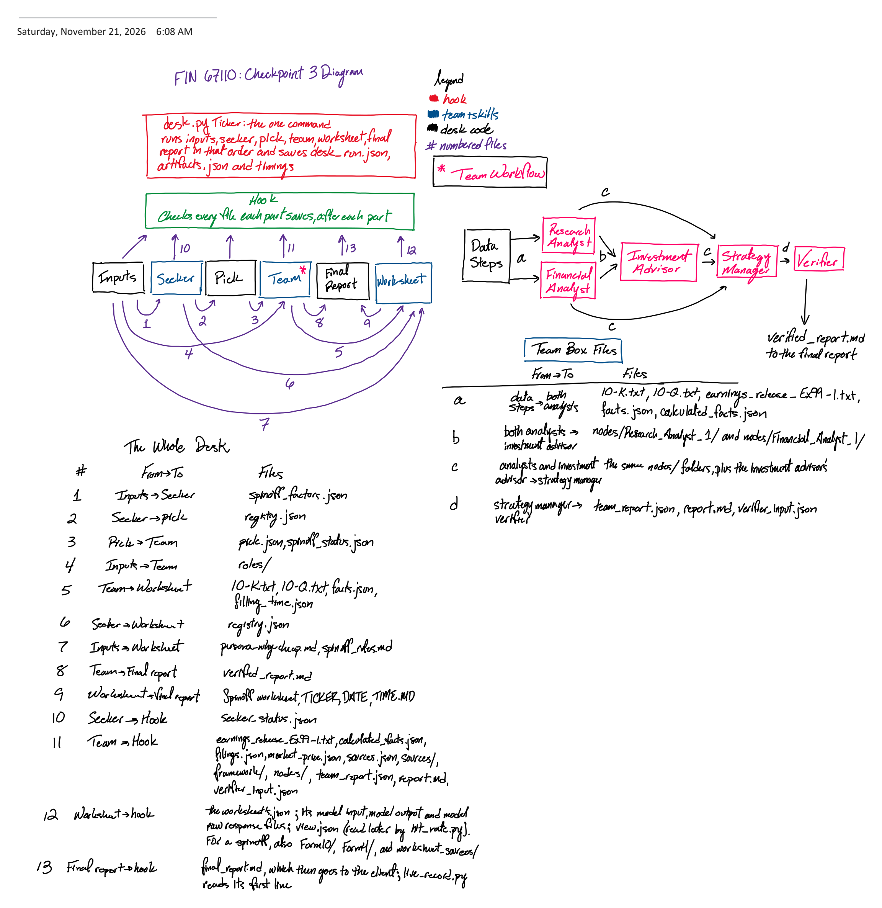

# Team LLK Analytics — gkotsivi-ui, jcleeper65, lee4276

Client: an investor seeking absolute return.

The desk:

The same diagram on GitHub: [docs/desk-diagram.png](https://github.com/gkotsivi-ui/fin67110-desk/blob/d4b96fcde6ff473753e95f60a8532dd9baf3237c/docs/desk-diagram.png)

The joins: the desk uses the pipeline everywhere, and the hook is the guard. `desk.py` runs the parts in a fixed order
(inputs, seeker, pick, team, worksheet, final report), and each part reads only the files the parts before it saved in
one run folder, so no part calls another: the pick and the worksheet read the seeker's `registry.json`, the worksheet
reads the team's saved filings and facts, and the final report joins the verified report and the worksheet's view in
code. The team's roles read the pick's files and the data steps' facts with a file tool; their instructions let them
quote those files and forbid them to recompute them, and no role calls the seeker or the worksheet as a tool. The hook
checks every file each part saves before the next part starts and refuses a number with no source. We chose the
pipeline because each part can be tested alone on a saved run folder, and `desk.py --replay` re-checks a saved run
with no network calls.

We own: the intelligent error review application, `desk_error_review.py` with its skill `desk-error-review`.

Roles:
- gkotsivi-ui: the base desk the team started from (the data steps that read SEC EDGAR, the eleven core claims, the roles, the Verifier and the closes reader) and its fixes, the Week 4 and Week 5 live runs and the live-record table, and the code audits and fixes of the joined desk.
- jcleeper65: the joined desk behind the one command (`desk.py`, the hook, the seeker and the worksheet, with the factor list, worksheet rules and persona), the error review application we own, the hit-rate table, and the live-record error documentation.
- lee4276: the test of the joined desk end to end on OpenAI's models (the five roles and the worksheet, on Walmart) and the fixes that test found.

Live record so far: https://github.com/gkotsivi-ui/fin67110-desk/tree/7285544/runs/live

| Week | Ticker | Release the report read | Filing time, "Accepted" on EDGAR (ET) | Commit, and its time (ET) | Inside the 24-hour window |
|---|---|---|---|---|---|
| Week 4 | CSCO | 8-K [0000858877-26-000170](https://www.sec.gov/Archives/edgar/data/858877/000085887726000170/0000858877-26-000170-index.html), [Exhibit 99.1](https://www.sec.gov/Archives/edgar/data/858877/000085887726000170/exhibit991pressrelease-q1f.htm) | 2026-11-12 16:06:24 | [`88015f7`](https://github.com/gkotsivi-ui/fin67110-desk/commit/88015f7b4ba5835225211dd578e05fcaef3c9767), 2026-11-13 13:17:26 | yes, 21.2 hours after the release |
| Week 5 | NVDA | 8-K [0001045810-26-000088](https://www.sec.gov/Archives/edgar/data/1045810/000104581026000088/0001045810-26-000088-index.html), [Exhibit 99.1](https://www.sec.gov/Archives/edgar/data/1045810/000104581026000088/q3fy27pr.htm) | 2026-11-17 16:20:51 | [`f55b170`](https://github.com/gkotsivi-ui/fin67110-desk/commit/f55b170fc5db8304426e27e394948b051d7591df), 2026-11-18 08:52:43 | yes, 16.5 hours after the release |

The table is made by `python live_record.py` from each report's first line, the 8-K's "Accepted" time on SEC
EDGAR, and the time of the commit that first added the report
([docs/live-record.md](https://github.com/gkotsivi-ui/fin67110-desk/blob/140c4b34c1961d5f5e418962e38f2d129c4557f5/docs/live-record.md)).

This is a learning exercise, not financial advice.

AI assistance: Claude Code. I verified the sources myself; the judgments are mine.

Any remaining errors are my own.
